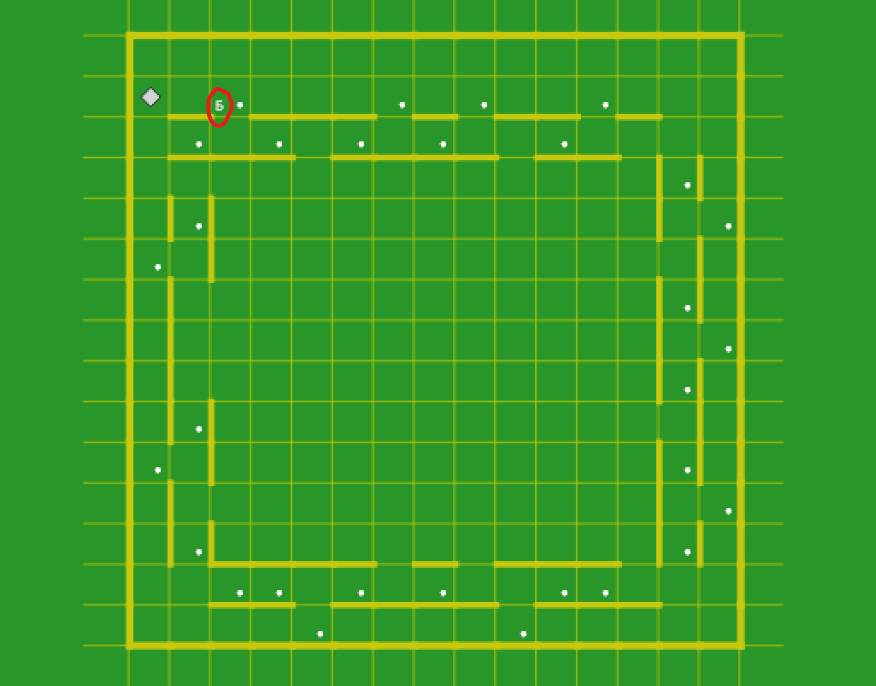

# Робот, коридор и ~~коза~~ база. Откройте дверь!

Разбор задачи 2 из вступительного испытания в Школу аналитиков данных МТС (набор 2026/27).
Я старался писать так, чтобы было понятно семикласснику: задача и правда взята из программы шестого класса.

Я написал робота, который проходит пример из условия, но на проверке он прошёл только 1 тест из 6.
Ниже я разбираю, почему так вышло и почему эта задача не столько про программирование,
сколько про то, как устроена картинка в условии.

## О чём задача

Есть исполнитель Робот из школьного языка КуМир. Он ходит по клетчатому полю вверх, вниз, влево и вправо,
умеет закрашивать клетку и проверять, есть ли рядом стена. Пройти сквозь стену он не может: программа падает.

Условие слово в слово:

> Робот стоит у входа в коридор. Он должен закрасить все отмеченные клетки и прийти на базу (в клетку, отмеченную буквой Б).
> В коридоре нужно закрашивать только те клетки, которые ограничены стенками с двух сторон.
>
> Длины стенок и число проходов считайте неизвестными. Нельзя использовать переменные, div и mod, собственные подпрограммы.
> Используйте цикл «пока» и сложные условия.

И картинка:



Серый ромб это робот, буква Б в красном кружке это база, белые точки отмечают клетки, которые надо закрасить, жёлтые линии это стены.
Вокруг поля идёт коридор шириной в одну клетку. У коридора две стенки, и в стенках есть дырки-проходы.

## Робот не видит букву «Б»

Робот чувствует только две вещи: есть ли рядом стена и закрашена ли клетка под ним. Буквы он не видит.
Значит, найти базу он может только одним способом: заранее знать, где на поле она обычно стоит.

А где обычно стоит база, показано ровно на одной картинке.

## Две половины задачи

**Первая половина: закрасить клетки.** Тут всё понятно. Робот идёт по коридору вдоль всех четырёх сторон.
В каждой клетке он смотрит:

- если стены с обеих сторон, закрашивает клетку;
- если снаружи дырка, а изнутри стена, шагает в дырку, закрашивает клетку снаружи и возвращается.

С этой половиной моё решение справляется на всех полях.

**Вторая половина: прийти на базу.** Здесь и случилась история.

## Одна картинка, две правды

Посмотрите на верхний левый угол картинки. Упрощённо он такой: `Р` это робот, `Б` база, `═` стенка, `░` дырка.

```
ряд 1   .   .   .   .   .
ряд 2   Р   .   Б   .   .      ← робот и база в одном ряду
           ═══ ░ ═══════        ← стенка коридора с дыркой
ряд 3   .   .   .   .   .
```

Про базу на этой картинке можно сказать две разные вещи, и обе будут правдой:

- **Правда А:** база стоит над первой дыркой в стенке.
- **Правда Б:** база стоит на две клетки правее того места, где робот начал.

На этой картинке они совпадают, и по ней невозможно понять, какая из двух правд настоящее правило.

Я выбрал правду А: мой робот после обхода коридора идёт вдоль верхней стенки до первой дырки и встаёт над ней.
Авторы задачи имели в виду правду Б.

## Что было на проверке

Решения проверяли на шести полях. Первое из них и есть картинка из условия, остальные пять заранее не показывали.
На схемах ниже `Р` означает старт, `Б` базу, `•` клетки, которые надо закрасить, `━` и `┃` стенки.

Вот тест 3: робот стоит в самом верхнем ряду, а первая дырка далеко справа.

```
┌──────────────────────────────┐
│ Р     Б           •          │
│   ━━━━━━━━━━━━━━━   ━━━      │
│    •  •     •        •       │
│   ━━━━━━   ━━━   ━━━━━━      │
│                       ┃ •┃   │
│                              │
│  ┃ •┃                 ┃    • │
│      ━━━━━━━━━━━━   ━━━      │
│       •  •     •             │
│      ━━━━━━   ━━━━━━         │
│             •        •       │
└──────────────────────────────┘
```

Правда Б работает: база на две клетки правее старта. Правда А ломается: до первой дырки далеко, и робот встаёт не там.

А вот тест 6. Здесь над стартом вообще нет стенки с дырками, и правде А не за что зацепиться.

```
┌─────────────────────┐
│ Р  •  Б  •  •       │
│                     │
│                     │
│   ━━━━━━━━━━━━      │
│              ┃    • │
│                     │
│ •   ┃        ┃    • │
│                     │
│ •   ┃        ┃    • │
│      ━━━━━━━━━      │
│                     │
│                     │
│       •  •  •       │
└─────────────────────┘
```

Во всех шести тестах база стоит ровно на две клетки правее старта. Это и есть правило авторов.

| Решение | Официальные тесты |
|---|---|
| эталон авторов | 6 из 6 |
| мой отправленный ответ | 1 из 6: закрашивает всё правильно, но приходит не на базу |
| мой первый вариант | 1 из 6, только другой тест |

Мою ошибку не спасает и строгое чтение условия. Условие объявляет неизвестными только длины стенок и число проходов,
а всё остальное, если читать строго, надо брать с картинки: старт во втором ряду, пустой ряд над ним,
база на две клетки правее старта. Тест 2 устроен ровно так, и на нём мой робот тоже приходит не туда:
левый коридор там короче, и заученный обход края стенки уводит робота мимо базы.
Так что моё решение ошибочно при любом прочтении условия.

Свои решения я проверял двумя мощными нейросетями: каждая решала задачу независимо, только по условию и картинке.
Обе пришли к тому же, что и я. Автор задачи пишет, что у ребят, которые прогоняли задачу через нейросеть,
она тоже не решилась. Похоже, нейросети дружно выбирают правду А.

## Как решили авторы

Эталон ([solutions/reference_authors.kum](solutions/reference_authors.kum)) обходит коридор так же, как мой робот.
А в конце действует так:

1. Поднимается к верхнему краю поля и спускается на ряд.
2. Идёт вправо, пока клетки чистые.
3. Если наткнулся на закрашенную клетку, значит, база стоит во втором ряду и отмечена точкой, как на картинке из условия.
   Робот её уже закрасил и находит по этому признаку.
4. Если закрашенной не нашлось, база в самом верхнем ряду. Робот идёт в левый верхний угол и делает «вправо, вправо».

В конце стоит «вправо, вправо». Эталон тоже не находит базу, а знает, что она в двух клетках от угла.
Это та самая правда Б, аккуратно записанная для двух случаев.

## На всех ли полях эталон прав?

Я попробовал найти поле, на котором ошибается и эталон. Правило игры такое: менять можно только то,
что условие объявляет неизвестным, то есть длины стенок и число проходов. Всё остальное остаётся как на картинке.

Я взял саму картинку из условия и менял на ней ровно одну стенку. Точки после каждой правки расставлены
по тому же правилу, что и в тестах. На схемах показан верхний левый угол поля, остальное не менялось.
Буквой `x` отмечено место, где остановился эталон.

**Поле А. Под базой нет дырки.** Кусок стенки под базой стал сплошным, проходов стало на один меньше.

```
┌───────────────────────────┄┄
│                            ┄
│                           
│ Р     Б           x     •  ┄
│   ━━━━━━━━━━━━━━━   ━━━   
│    •  •  •     •     •     ┄
│   ━━━━━━━━━   ━━━━━━━━━━━━
│                            ┄
│                           
│  ┃ •┃                      ┄
│                           
┆
```

Клетка базы больше не отмечена точкой. Эталон ищет её по закрашенной клетке, не находит и уходит вправо
до первой закрашенной клетки, далеко от базы.

**Поле Б. Лишняя дырка рядом со стартом.** В стенке под клеткой между стартом и базой появился проход,
проходов стало на один больше.

```
┌───────────────────────────┄┄
│                            ┄
│                           
│ Р  x  Б           •     •  ┄
│         ━━━━━━━━━   ━━━   
│          •     •     •     ┄
│   ━━━━━━━━━   ━━━━━━━━━━━━
│                            ┄
│                           
│  ┃ •┃                      ┄
│                           
┆
```

По правилу задачи клетка над новой дыркой отмечена точкой, и робот её закрашивает. Эталон принимает
первую закрашенную клетку за базу и останавливается на ней, не дойдя одной клетки.

**Поле В. Левая стенка коридора длиннее на одну клетку.** Изменилась только длина стенки.

```
┌───────────────────────────┄┄
│                            ┄
│                           
│ Р     Б           •     •  ┄
│   ━━━   ━━━━━━━━━   ━━━   
│    •     •     •     •     ┄
│   ━━━━━━━━━   ━━━━━━━━━━━━
│  ┃ x                       ┄
│                           
│  ┃ •┃                      ┄
│                           
┆
```

Эталон в конце делает шаг влево, рассчитывая, что там свободно. Теперь там стена, и робот в неё врезается:
программа падает.

| Решение | А: под базой нет дырки | Б: лишняя дырка у старта | В: левая стенка длиннее |
|---|---|---|---|
| эталон авторов | приходит не на базу | приходит не на базу | врезается в стену |
| мой ответ | приходит не на базу | приходит не на базу | врезается в стену |

Каждое из трёх полей отличается от картинки условия одной стенкой и меняет только то, что условие
объявило неизвестным. Мой ответ на них тоже ошибается, так что лучшим решением он от этого не становится.
Эти поля показывают другое: и эталон опирается на расположение стенок у старта, которое условие не фиксирует.

Ещё одна деталь. В тестах 3–6 старт стоит в самом верхнем ряду, без пустого ряда над ним.
По строгому чтению это тоже не длина стенки и не число проходов, то есть тесты меняют чуть больше, чем объявлено в тексте.
Думаю, для авторов это была несущественная деталь: где начинается поле, неважно, важен коридор.
Это разумный взгляд. Но если его принять, видно, что разумных прочтений картинки несколько,
и угадать нужно было именно авторское.

## При чём тут Монти Холл

Есть знаменитая задача про три двери, козу и автомобиль, [парадокс Монти Холла](https://github.com/kogriv/Stata/tree/main/problems/07_monty_hall).
Её главный урок: вероятность зависит не только от того, что вы видите, но и от того, как это получилось.
Одна и та же картинка «две закрытые двери, за открытой коза» даёт шанс выигрыша и 2/3, и 1/2, и вообще что угодно от 0 до 1,
смотря по каким правилам действует ведущий. Можно [сыграть в браузере](https://kogriv.github.io/Stata/problems/07_monty_hall/game/) с разными ведущими и убедиться.

С роботом то же самое. Картинка одна, а правил, по которым её могли нарисовать, несколько.
Чтобы пройти все тесты, надо было понять не только алгоритм, но и то, как автор рисует свои поля.
Монти Холл знал, за какой дверью машина. Автор задачи знал, где стоит база.
А я и две нейросети смотрели на одну картинку и дружно открыли дверь с козой.

## Что я из этого вынес

Советы для семиклассника и для тех, кто поступает на аналитика данных:

- Если в условии одна картинка, а тестов шесть, то картинка не правило, а один пример.
  Перед тем как писать код, стоит спросить себя: что на этой картинке могло бы быть по-другому?
- Полезно нарисовать себе ещё пару полей, которые условию не противоречат, и прогнать на них решение.
  Я так и сделал, но рисовал поля, похожие на картинку, и ошибку не поймал.
- Если картинку можно прочитать по-разному, решает то, как её задумал автор. Автор так и пишет:
  выбирать более достоверный источник и обобщать решение на непоказанные случаи пока ещё область,
  где человек сильнее ИИ. Мой случай это подтверждает: две нейросети выбрали не ту трактовку.

Аналитику данных стоит сначала спросить, какой процесс породил данные. Даже если данные это картинка с роботом.

## Что лежит в репозитории

| Файл | Что это |
|---|---|
| [solutions/reference_authors.kum](solutions/reference_authors.kum) | эталон авторов из их опубликованного разбора |
| [solutions/ours_submitted.kum](solutions/ours_submitted.kum) | мой отправленный ответ |
| [solutions/ours_first_attempt.kum](solutions/ours_first_attempt.kum) | мой первый вариант, ошибся в другом месте концовки |
| [tests/official_fields.json](tests/official_fields.json) | шесть официальных тестовых полей, перерисованные в данные |
| [tests/variants.json](tests/variants.json) | три поля по строгому чтению условия, на которых ломается эталон |
| [robot.py](robot.py) | маленький симулятор Робота |
| [check_all.py](check_all.py) | прогон всех решений на всех полях |

Для запуска нужен только Python 3.10+:

```
python check_all.py          # таблица результатов
python check_all.py --draw   # плюс схемы всех полей
```

Официальные поля я перерисовал по картинкам из опубликованного разбора. Число отметок на каждом поле совпало с официальным,
и эталон авторов проходит на них все шесть тестов, так что перерисовка верная.

## Источники

- Условия задач, эталонные решения и тест-кейсы опубликовал руководитель Школы аналитиков данных МТС
  в канале [datarascals](https://t.me/datarascals) после окончания отбора. Задача и эталон приведены по этому разбору.
- Песочница КуМира, на которую ссылались организаторы: [qumir.dev](https://qumir.dev/docs-static/index.html).
- Разбор [парадокса Монти Холла](https://github.com/kogriv/Stata/tree/main/problems/07_monty_hall) и [игра с разными ведущими](https://kogriv.github.io/Stata/problems/07_monty_hall/game/).
